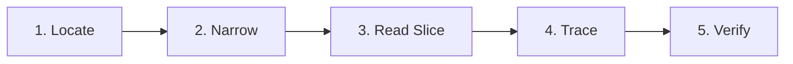

# 🔍 codebase-search kit

[](https://opensource.org/licenses/MIT)
[](https://github.com/BurntSushi/ripgrep)
[](https://www.gnu.org/software/bash/)
[](#2-quick-install-recommended)

> **Stop LLM context bloat.** Makes any coding agent search a codebase fast, cheaply, and methodically — glob to locate, ripgrep to narrow, ranged reads to inspect, and disciplined playbooks for hard multi-hop traces.

---

## ⚡ Why This Exists

Most AI coding assistants waste massive amounts of tokens (and time) reading entire files, dumping whole directory trees, or guessing paths. 

**codebase-search kit** fixes this by equipping your agent with:
1. **Compact Always-On Rules (~50 lines):** Forces disciplined search behavior (locate $\rightarrow$ narrow $\rightarrow$ read a slice $\rightarrow$ trace $\rightarrow$ verify).
2. **Comprehensive Search Playbook:** Concrete procedures for hard concept searches, hypothesis-driven debugging, and token cost ladders.
3. **High-Speed Helper Script (`search.sh`):** A battle-tested ripgrep wrapper with automatic fallback to `git grep` and `grep`.

---

## 📂 Repository Contents

```text
codebase-search-kit/
├── README.md                     <- Master documentation
├── LICENSE                       <- MIT License
├── install.sh                    <- Universal installer for all coding agents
├── core/
│   ├── RULES.md                  <- Compact always-on rules (appends inside markers)
│   ├── PLAYBOOK.md               <- Full playbook: hard searches, cost ladders, speed tuning
│   └── search.sh                 <- Fast ripgrep helper with grep fallbacks
├── skill/
│   └── codebase-search/          <- Claude Code native skill bundle
│       ├── SKILL.md
│       └── scripts/search.sh
└── releases/
    └── codebase-search-kit.zip   # Offline standalone package
```

---

## 1. Prerequisites

| Tool | Purpose | Install Command |
| :--- | :--- | :--- |
| **ripgrep (`rg`)** | Fast search engine *(recommended)* | **macOS:** `brew install ripgrep`<br>**Windows:** `winget install BurntSushi.ripgrep.MSVC`<br>**Ubuntu/Debian:** `sudo apt install ripgrep` |
| **bash** | Runs `install.sh` and `search.sh` | Built-in on macOS/Linux. On Windows, use **Git Bash** or **WSL**. |
| **git** | History searches (`hist` command) | Usually pre-installed. |
| **ast-grep** *(optional)* | Structural AST pattern search | `npm i -g @ast-grep/cli` or `brew install ast-grep` |

*Note: Without `rg`, `search.sh` automatically falls back to `git grep` and GNU `grep`.*

---

## 2. Quick Install (Recommended)

Clone the repository (or extract `codebase-search-kit.zip`) and run `install.sh`:

```bash
git clone https://github.com/SonuSV7719/codebase-search-kit.git
cd codebase-search-kit
chmod +x install.sh
./install.sh <agent> /path/to/your/project
```

### Supported Agents Matrix

| Agent / IDE | Command | Target Rules File |
| :--- | :--- | :--- |
| **OpenAI Codex** (and tools reading `AGENTS.md`) | `./install.sh codex .` | `AGENTS.md` |
| **Claude Code** (Project Rules) | `./install.sh claude .` | `CLAUDE.md` |
| **Claude Code** (Full Custom Skill) | `./install.sh claude-skill .` | `.claude/skills/codebase-search/` |
| **Gemini CLI / Antigravity** | `./install.sh gemini .` | `GEMINI.md` |
| **Cursor** | `./install.sh cursor .` | `.cursor/rules/codebase-search.mdc` |
| **GitHub Copilot** | `./install.sh copilot .` | `.github/copilot-instructions.md` |
| **Windsurf** | `./install.sh windsurf .` | `.windsurf/rules/codebase-search.md` |
| **Cline / Roo Code** | `./install.sh cline .` | `.clinerules` |
| **Aider** | `./install.sh aider .` | `CONVENTIONS.md` |
| **Universal (All Agents)** | `./install.sh all .` | Installs across all rule files above |

> **Safety Guarantee:** The installer appends inside `<!-- codebase-search:start -->` and `<!-- codebase-search:end -->` tags. It will **never** overwrite your existing custom instructions. Use `--force` to re-install.

---

## 3. Helper Script (`search.sh`) Quick Reference

The helper script provides high-speed, noise-filtered, capped searches:

```bash
# File and directory navigation
.codebase-search/search.sh layout                         # Show directory tree layout and file counts
.codebase-search/search.sh files   "auth"                 # Find files by filename / path

# Content searches (ripgrep-accelerated)
.codebase-search/search.sh text    "createUser" src       # Line-numbered content search scoped to src/
.codebase-search/search.sh def     UserService            # Jump directly to symbol definitions
.codebase-search/search.sh refs    UserService            # Find whole-word symbol references
.codebase-search/search.sh ctx     "retry|backoff"        # Context search (-C3 around hits)
.codebase-search/search.sh count   "TODO"                 # Hit count breakdown per file
.codebase-search/search.sh slice   src/auth.ts 40 90      # Read precise line range (never dump whole files)

# Multi-condition & Git history
.codebase-search/search.sh both    "fetch(" "catch"       # Find files containing BOTH terms
.codebase-search/search.sh missing "fetch(" "catch"       # Find files containing A but missing B
.codebase-search/search.sh hist    "OLD_FLAG"             # Git history: who added or removed text
.codebase-search/search.sh ast     'console.log($$$)' ts  # AST pattern search (requires ast-grep)
```

---

## 4. The 5-Step Agent Loop

When installed, your agent follows this strict efficiency loop:



1. **Locate:** Find target files cheaply using filename globs (`search.sh files`) or file-only search (`rg -l`).
2. **Narrow:** Scope hits to specific directories, file extensions, or word boundaries (`-w`).
3. **Read Slice:** Read 40–120 lines around the match (`search.sh slice`), never whole files.
4. **Trace:** Follow definitions (`def`), call sites (`refs`), imports, routes, and tests.
5. **Verify:** Confirm changes with the smallest possible diff before modifying code.

---

## 5. Cost Ladder (Cheapest First)

| Tier | Operation | Tool / Command | Token Cost |
| :---: | :--- | :--- | :---: |
| **1** | File name / path search | `rg --files \| rg -i "<pattern>"` | **Lowest** |
| **2** | Files-only content list | `rg -l -F "<text>"` | Minimal |
| **3** | Hit counts by file | `rg -c "<text>"` | Low |
| **4** | Capped line search | `rg -n -m 5 "<text>" <dir>` | Low |
| **5** | Contextual search (1-3 files) | `rg -n -C3 "<text>" <file>` | Medium |
| **6** | Ranged slice read | 40-120 lines around hit | Controlled |
| **7** | Full file reads | *Only as an absolute last resort* | High |

---

## 6. Self-Test

Test that your agent respects the protocol by asking:
1. *"Where is `<function_name>` defined and who calls it?"*
2. *"Trace what happens from the `<route/UI element>` to the database write."*
3. *"List every place that calls `<API>` without error handling."*

**Expected Behavior:** The agent runs fast parallel `rg` / `search.sh` queries, cites findings in `path:line` format, reads small line slices, and never prints entire files into the conversation.

---

## 7. License

Distributed under the [MIT License](LICENSE). Free for personal, commercial, and enterprise use.
